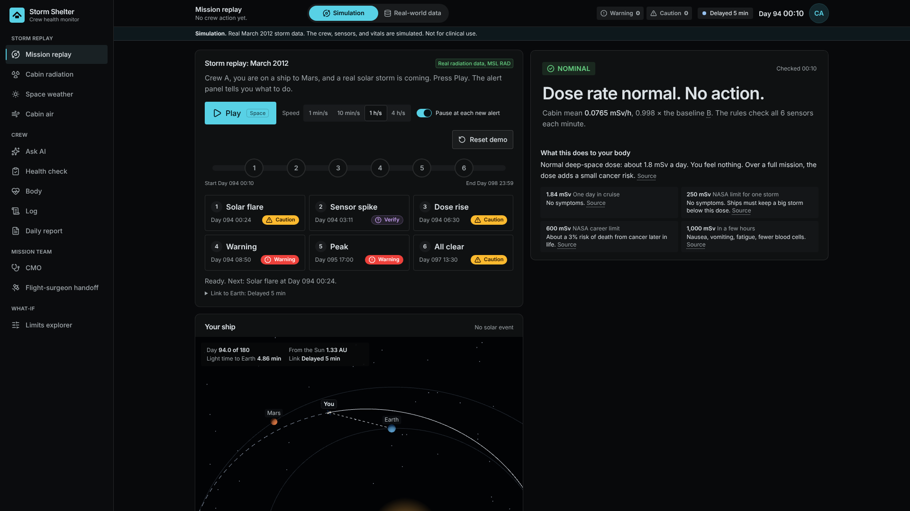
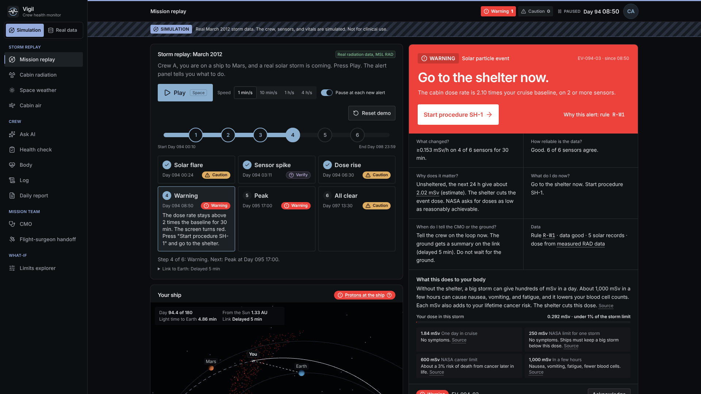
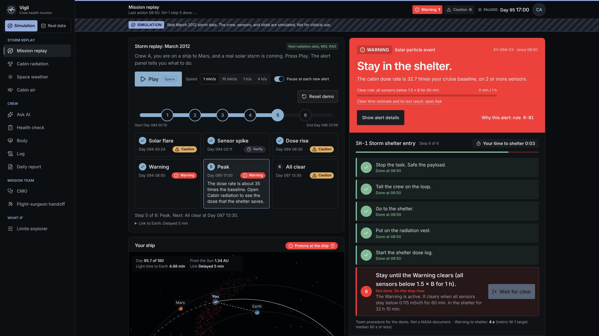
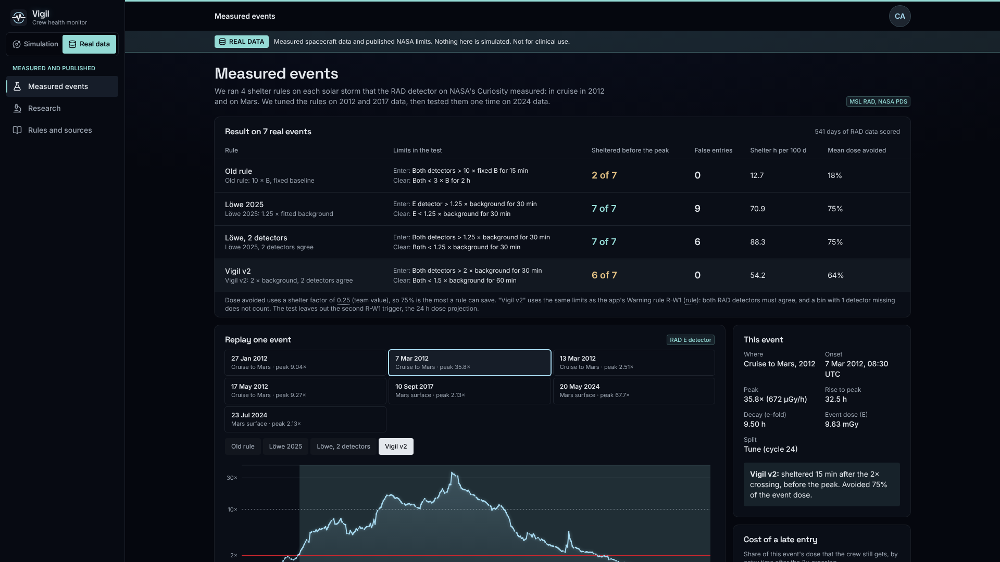

# Vigil


A crew health monitor for one astronaut on a Mars transit. It watches radiation, cabin air, and body systems, and tells the crew what to do. CSI entry for NASA Space Apps 2026, challenge "Create Health Monitoring Software for Astronauts on Space Missions."

The tool answers one question when Earth cannot answer in time:

> What is my radiation risk now, and what do I do?

**Not for clinical use.** The radiation event is measured data: the MSL RAD detector on the 2012 cruise to Mars. The solar event records are the real records of 5 to 7 March 2012. The sensor spread, cabin air, and crew vitals are simulated, and the app marks them with the Simulation band on every view.

The rules come from tests on 7 real solar particle events. See `research/realdata/RESULTS.md`. A later study tested the rules on 40 years of GOES proton data, the full MSL RAD record, and 17 years of LRO CRaTER data, with a held-out test on 2020 to 2026. See `research/frontier/RESULTS.md` and the Research view in the app.

## Run it

```bash
npm install
npm run dev        # open the printed local URL
npm test           # rules engine, forecast, and assistant tests
npm run build      # static, offline-ready build in dist/
npm run preview    # serve the build
npm run lint       # ESLint
npm run check      # lint, tests, and build
npm run e2e        # end-to-end and accessibility tests (Playwright, axe) on the build
```

### Checks

`.github/workflows/ci.yml` runs `npm run check` and `npm run e2e` on each pull request and on each push to `main`. `npm install` also turns on the pre-push hook (`.githooks/pre-push`), so each `git push` runs `npm run check` first and stops the push if the lint, a test, or the build fails.

`e2e/app.spec.ts` drives the build on a desktop and a phone screen. It checks the Warning and Leave shelter steps and the note reader, and it runs axe (WCAG 2.1 AA) on 11 views.

The build is a static site. It works from any folder and from GitHub Pages. After the first load, it works with the network off (service worker cache).

## The 2-minute demo

The app opens on **Mission replay**. The top panel holds the demo: 3 short instructions, Play and speed, a time track, and 6 steps. Each step jumps to one moment of the real March 2012 event. Under the panel, the ship moves on its way to Mars, and the alert panel tells the crew what to do. On a phone, only the current step shows; the track gives the others.

| Step | Mission time | What you see |
| --- | --- | --- |
| 1 Solar flare | Day 94 00:24 | The X5.4 flare and the fast CME give a Caution (rule R-C1). The dose rate at the ship is still normal. |
| 2 Sensor spike | Day 94 03:11 | One sensor jumps. The app gives Verify, not a Warning, because only 1 sensor agrees. |
| 3 Dose rise | Day 94 06:30 | Protons reach the ship. The cabin dose rate passes 1.5 × the baseline. |
| 4 Warning | Day 94 08:45 | At 2 × the baseline on 2 or more sensors for 30 min, rule R-W1 gives a Warning. Tap **Start procedure SH-1**. |
| 5 Peak | Day 95 17:00 | The dose rate is about 35 × the baseline. **Cabin radiation** shows the dose that the shelter saves. |
| 6 Leave shelter | Day 98 02:30 | All sensors stay below 1.5 × the baseline for 1 h. The Warning drops to Caution. You can leave the shelter. |

`tests/demo.test.ts` checks that each step shows the level that it names. **Reset demo** clears the replay. A jump back in time copies the world at the demo start (`World.clone()`), so it does not replay 6 days of data.

Open **Real-world data > Measured events** to show the rule results on all 7 events.

## Demo video

[`docs/demo/storm-shelter-demo-30s.mp4`](docs/demo/storm-shelter-demo-30s.mp4) (28 s, no sound). Screens of the final build: the 6 demo steps, the shelter procedure, Space weather, and the rule test on the measured events.

## Preview images

Screens of the final build in [`docs/preview/`](docs/preview/): desktop at 1920 x 1080 and phone at 390 x 844.






## Use of SI (AI) tools

The team used Super Intelligence (SI) tools on this project, as listed below.

- **Code.** Claude (Anthropic) with Claude Code wrote most of the app code, the tests, and the Python research scripts. The team set the goals, reviewed the code, and checked the results.
- **Research and text.** Claude helped to search the literature, check the citations, and write the README, the PRD, and the result reports. Each citation was checked against Crossref, PubMed, arXiv, or the NASA PDF (see "Source audit" below).
- **Data analysis.** Claude wrote and ran the scripts that get and score the GOES, MSL RAD, and LRO CRaTER data. The data is measured data from the public archives. No data value is AI-generated.
- **Demo video and preview images.** They are screen captures of the real app. Claude drove the app in a headless browser, took the screen captures, and wrote the captions.
- **In the app.** Ask AI can send facts to an optional model: Llama 3.2 in the browser (WebLLM), Claude with the user's API key, or an OpenAI-compatible API. The built-in assistant does not use a model.
- **Images.** The app has no AI-generated images. It uses no NASA logo or NASA design element.

## Layout

The app has 2 modes. The **Simulation | Real-world data** switch is at the top of the sidebar on a wide screen and in the top bar on a phone. A band under the top bar names the mode on every view, so the panels need no "Simulated" labels.

- **Simulation.** Mission replay (the landing page), Cabin radiation (inside the ship: sensors, dose chart, dose budget, crew timeline), Space weather (outside the ship: solar records, distance and angle to Earth), Cabin air, the crew views (Ask AI, Health check, Body, Log, Daily report), the team views (CMO, Ground link), and the **Limits explorer**.
- **Real-world data.** Measured events (the rule test on 6 RAD events), Research, and Rules and sources.

The **Limits explorer** is a what-if tool. Type a value for each factor (radiation dose rate, CO2, temperature, humidity, ppO2, pressure) and pick an area (ship cabin, storm shelter, Mars surface habitat). It shows the level of each value and the dangerous range in each area. The zones come from `src/engine/limits.ts`, which reads `rules.json` and `cabin-rules.json`. The Cabin air view uses the same zones.

## Number style

`src/engine/units.ts` is the only place that rounds a value. It follows the NASA technical publication style and the MSL RAD papers (for example 1.84 mSv/d and 0.481 mGy/d):

- Measured and modeled values: 3 significant figures, a zero before the decimal point, and a comma between thousands (`fmt`).
- Counts and percents of a whole: whole numbers (`whole`).
- Limits and rule thresholds: the value as the standard or `rules.json` defines it (for example 600 mSv and 3 mmHg).

## What is in this build

| PRD item | Where |
| --- | --- |
| FR-01 Dose-rate monitor, 4 alert rules | `src/engine/world.ts`, `src/data/rules.json` |
| FR-02 Solar event watch (DONKI never sets Warning) | `src/engine/donki.ts`, **Space weather** |
| FR-03 Shelter procedure SH-1 | Opens in place in the alert panel. 1 tap from the Warning. |
| FR-04 Dose budget and waiver state | Dose budget panel and career chart |
| FR-05 Timeline band | Crew timeline on **Cabin radiation** |
| FR-06 Source panel | Tap any underlined value or a **Source** button |
| FR-07 Delay switch | Link control in the demo panel and on **Ground** |
| FR-08 Replay mode, labels | Demo panel on **Mission replay**. "Replay" tags and the Simulation band. |
| FR-09 Alert counter | Alert bar, and the alarm-burden card on **Log** |
| FR-10 Privacy control | Health check "Who can see this entry", and the selector on each log entry |
| FR-11 Ground summary | **Ground**. Built when the link returns from a blackout. |
| FR-12 CMO case view | **CMO** |
| FR-13 Combined-effects note | **CMO** (infection watch, evidence "emerging") |
| FR-14 Body systems (scope change 3B) | **Body**. Rules B-RAD1 to B-B2 in `src/data/body-rules.json`. Advisory or Caution only. They do not count toward M-3. |
| FR-15 Display mode | **Profile** (initials in the top bar). Dark is the default. |
| Profile | Name, role, and look. Stored in this browser only. `src/app/profile.ts` |
| Body effects | Under the alert panel: what the dose at each level does to the body, your storm dose against the 250 mSv storm limit, and a cited dose ladder. `src/app/health.ts` |
| Daily report | **Daily report**: what needs attention, alerts, solar events, check-ins, and the log for one day. JSON download, or PDF from the print window. `src/app/report.ts` |
| Voice input | A microphone button beside each crew input: Ask, Profile name, Limits explorer values, and each part of the Health check (sleep hours, sleep quality, mood, pain, and note). Typing and taps still work. Spoken numbers ("six and a half") and scale words ("pretty good") are read by `spokenNumber` and `spokenStep` in `src/app/noteReader.ts`. Only 1 microphone listens at a time. In a browser without the Web Speech API, the button is disabled and says why. `src/app/Mic.tsx` |
| AI engines | **Ask AI**: built-in (offline), a model in the browser (WebLLM, WebGPU), Claude with your API key, or any OpenAI-compatible API. `src/app/ai.ts` |
| Onboard assistant (Phase 5) | **Ask**. `src/app/assistant.ts`. See "Onboard assistant" below. |
| Last 12 h brief (Phase 6) | **Ask**, topic `brief` in `src/app/assistant.ts` |
| Check-in note reader (Phase 6) | `src/app/noteReader.ts`. Suggestions under the note on **Health check**. |
| Clear-time estimate (Phase 5) | `src/engine/forecast.ts`. In the Warning panel during a shelter stay, and in **Ask**. |
| NFR-01 Offline | `vite-plugin-pwa`. Fonts ship with the app. |
| NFR-02 Units | `src/engine/units.ts`. Two factors in `rules.json`: 3.83 mSv per mGy for the GCR baseline and 1.77 for the solar proton dose above it. The rules count multiples of the absorbed dose rate. |
| NFR-04 Gloved touch | 40 to 60 px targets, 48 px for crew actions. No drag or hover controls. |
| NFR-05 Display rules | Red only for Warning, yellow only for Caution, each with an icon and a word |
| NFR-07 Audit | Append-only, frozen log entries. Export as JSON on **Daily report**. |
| NFR-08 Labels | The mode line under the top bar: what is measured, what is simulated, and "Not for clinical use" |

### Interface

React 19, Tailwind CSS 4, shadcn/ui (Radix), Motion, Recharts, and three.js. See `docs/design-notes.md`.

- **Colors.** Dark (default) is deep space: a blue-black ground, pale starlight text, and one pale ice-blue accent with a soft glow for controls and data lines. The status colors are pale and cool. Red is only for Warning, and amber is only for Caution. Light mode is in the profile.
- **Data mode.** The app has 2 modes: Simulation and Real-world data. Each mode has its own color (pale violet or pale teal), icon, and name. A band under the top bar names the mode on every view. Simulation also has diagonal stripes, so the mode does not depend on color alone.
- **Live replay.** A new replay starts by itself at 1 min/s, so the mission clock moves on the first screen. At the first alert it pauses and switches to 1 h/s. The top bar shows "Live" while time moves, and the readings glide to each new value.
- **Alert panel.** It fills with red or yellow during an alert. SH-1 opens in place. A Warning cannot be suppressed. Rule inhibit is on **Rules and sources** only, a banner shows each inhibited rule on every view, and 2 sensors at 10 × B for 5 min always give a Warning.
- **Speed.** Each view except the landing page loads on first use. The dose chart rebuilds each 10 to 30 replay minutes, not each tick, and the panels have no blur. With the CPU slowed 4 times, the replay runs at about 60 frames per second on Mission replay.
- **Offline.** A service worker keeps the app after the first load.

## Onboard assistant (Phase 5)

The assistant runs on the crew laptop with no network and no model download. It reads the world. It cannot act: it has no path to a crew action, so it cannot acknowledge, suppress, or inhibit an alert, or change a rule.

- **Questions.** A question goes to the nearest of 138 example questions (TF-IDF, cosine score). Below a score of 0.4, the assistant says that it has no answer. It does not guess.
- **Answers.** Each answer comes from the live state (alerts, log, dose, sensors, cabin, body rules, link) or from `rules.json` and `sources.json`. Each answer lists its sources. The same state gives the same answer.
- **Refusals.** A request for a diagnosis, a treatment, or a change to an alert or a rule gets a fixed refusal that points to the CMO or to the alert controls.
- **Last 12 h brief (Phase 6).** "What happened in the last 12 h?" lists the alerts, clears, and findings from the log, the dose and the shelter time in the window, one line on the solar records (count, strongest flare, fastest CME, proton event start), and the alert that is open now. It is for a crew member who wakes up during an event. At day 94 06:00 in the replay, it shows the Caution from the X5.4 flare, the false S3 spike that opened and cleared a Verify, and the proton event.
- **Check-in note reader (Phase 6).** The health check reads the free-text note and shows the symptom chips that it names, for example "head feels full" gives Stuffy head. A cue word earlier in the same clause ("no", "not", "without", "n't") cancels a match. The clause ends at a comma, "and", "but", or a full stop, so "Not sleeping well, headache all day" gives Headache. It only suggests. The crew taps to mark, and the body rules read marked symptoms only. A missed symptom is the safe error, because the crew can still mark it by hand.
- **Clear-time estimate.** After the peak of a Warning, the estimate fits the decay time of the last 8 h of the event (a straight line through the log of the dose rate). It projects the fall to the clear line, plus the 1 h clear hold. The range comes from the other measured RAD events: the smallest and the largest ratio of the real time left to the projected time left. The replayed March 2012 event is not in its own range. In a leave-one-out test on the 7 events, the real clear time was in the range at 99% of 469 checks (465 hits, 3 later, 1 earlier). The old analog method reached 60%. A later test on 34 new shelter stays (CRaTER and RAD, 2020 to 2026) gave 90%. See `research/frontier/RESULTS.md`. The range is wide: its median width is about 38 h, for a median of about 19 h left. The estimate never opens, holds, or clears an alert.

### AI engines

Pick the engine on **Ask AI**. The built-in assistant always runs first:

- A refusal (diagnosis, treatment, a change to an alert) never goes to a model.
- For other questions, the model gets only the facts: the alert now, the built-in answer, and the body effect of the level. It rewrites them in plain words. "Facts the AI used" under each answer shows them.
- **On this device.** WebLLM runs Llama 3.2 (1B or 3B) on the GPU (WebGPU, Chrome or Edge). The first load downloads the model. After that, it works offline. The 6 MB runtime loads only when you pick this engine.
- **Claude** or **Other API.** Paste your own key. It stays in this browser (localStorage) and goes only to that provider. The repository holds no key.
- Vigil checks each number in the model answer against the facts (`newNumbers` in `src/app/ai.ts`). An answer with a new number is not shown. The card says why and shows the built-in answer.
- If a model call fails, the card says why and shows the built-in answer.

`npm test` checks the daily report, the AI facts, the matching on new wordings, the brief on the replay night, the note reader with negation, the refusals, the no-answer case, the read-only rule, the source of each answer, and the forecast test.

## Edit the rules

All radiation thresholds, timings, and sources are in `src/data/rules.json`. The body-system rules are in `src/data/body-rules.json`. The Science owner can change a value with no code change. Run `npm test` after a change. The tests check the day 94 story on the real March 2012 data.

The mission, sensors, schedule, sensor faults, and the SPE dose profile are in `src/data/mission.json`.

## Data files

- `src/data/real/rad-replay.json`: RAD E and B dose rates, 5 to 11 March 2012, 15-min bins. `research/realdata/export_app.py` writes it. A Hampel filter removes short dropouts (for example 8 March 11:00). RAD measures about every 30 min, so 261 of the 672 bins have no accepted value. `filled` lists them. The app draws them dotted, and the alarm timers do not count them. Cabin sensors S1, S3, and S5 follow detector E, and S2, S4, and S6 follow detector B.
- `src/data/real/rad-events.json` and `l1-summary.json`: the test results for the Measured events view.
- `src/data/real/frontier.json`: the results of the frontier study for the Research view. `research/frontier/summary.py` writes it.
- `src/data/replay-donki.json`: the real flare, CME, and SEP records of March 2012, in the DONKI schema.
- `src/data/cabin-rules.json`: cabin air limits from NASA-STD-3001 Vol 2.

## Open items for the team

- **Source check.** The PRD credits the cruise rate (1.84 mSv/d) to Hassler et al. 2014. That rate comes from Zeitlin et al., Science 2013 (MSL cruise). Hassler 2014 gives the surface rate (0.64 mSv/d). `sources.json` uses the correct papers.
- **Unit factor.** The one mGy-to-mSv factor (3.83) comes from the RAD cruise data. It overstates SPE dose (the SPE factor is about 1.77). The source panel says so.
- **Background fit (fixed 9 November 2026).** When an event filled most of the 5-day window, the old fit used the window median. On 10 March 2012 that put the event into the background, and the replay cleared the Warning about 12 h early. The fit now uses the lowest 20% of the window in that case. Only the March 2012 numbers changed. See `research/realdata/RESULTS.md`.
- **May 2024 dose.** The NASA press release gives 8,100 µGy for an astronaut next to Curiosity on 20 May 2024. It does not name the quantity. In the RAD data, detectors B and E agree. Against the median rate before 20 May, the excess dose from 20 to 24 May is 1.60 mGy (B) and 1.76 mGy (E), with no data gaps. So the choice of detector does not cause the difference. We did not find the cause.
- **Source audit (Phase 7, 9 November 2026).** Each citation was checked against Crossref, PubMed, arXiv, or the NASA PDF.
  - The Artemis I paper is George et al., Nature 634:48-52 (2024). Berger is a coauthor. The old entry gave the wrong first author, title, and volume.
  - The 250 mSv value is [V1 4031] in NASA-STD-3001 Vol 1 Rev C: a design limit for the reference SPE (sum of the October 1989 events). The old label called it a 30-day limit for blood-forming organs.
  - The 1,000 mSv ESA / CSA / Roscosmos limit comes from National Academies 2021, Table 3-1.
  - The shelter factor 0.25 stays a team value. Orion data give 0.23 (model of the October 1989 SPE) and 0.47 (measured in the proton belt).
  - Barger 2014 gives a mean of 5.96 h of sleep on the shuttle and 6.09 h on the ISS.
  - `tests/engine.test.ts` now checks that each source key in the data files exists.
- **Validate** the NOAA S1 and DONKI SEP definitions, and the "Appendix F" alert class reference in NASA-STD-3001 Vol 2. We could not get the Vol 2 Rev D PDF.
- **Event rules (RK-04).** Check if the 2026 rules allow code written before 14 November.

See `docs/design-notes.md` for the design system and the screen decisions.
