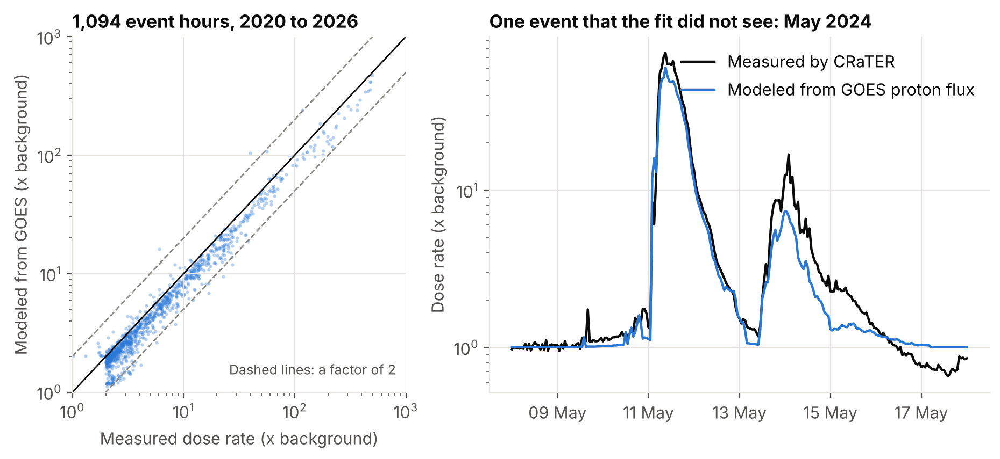
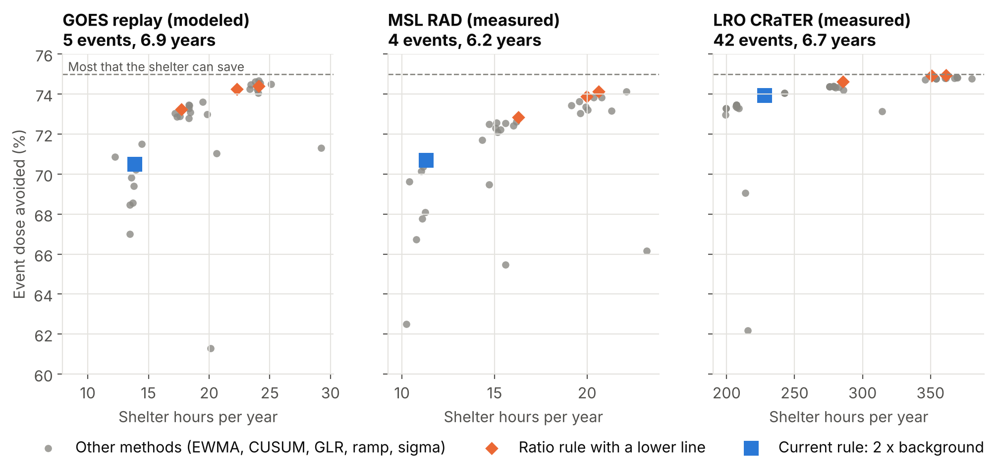
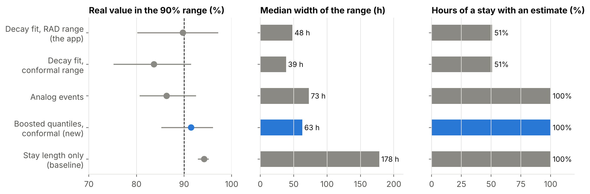
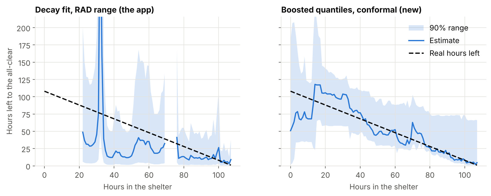

# Frontier study: shelter entry and clear time, tested on 40 years of events

Date: 14 November 2026. Code: `research/frontier/`. All numbers below come from `out/*.json`.

Labels: **measured** = instrument data. **modeled** = GOES flux through a fitted detector response. **team value** = an assumption of the team.

## 1. Why we did this study

Vigil makes 2 decisions for the crew: when to enter the shelter, and when to leave it. The earlier tests used 6 solar particle events from one instrument (MSL RAD). This study starts again with 3 questions:

1. How much do 6 events prove?
2. Is the current entry rule the best rule? Earlier work compared rules at different alarm rates, so a rule could win only because it alarms more.
3. Can the tool give the hours left in the shelter, with a range that is honest on new events?

## 2. Results in short

| Question | Answer |
|---|---|
| How much do 6 events prove? | Little. 6 of 6 proves a detection rate of 60.7% or more (95% bound). The new data has 83 measured events. The rule entered the shelter in 83 of 83. That proves 96.5% or more. |
| Can GOES proton flux stand in for a dosimeter? | Yes, within a factor of 2. At LRO CRaTER (most shielded pair), 97.6% of the event hours of 2020 to 2026 agree within a factor of 2. The fit did not use these years. The model reads 15% low there. |
| Is there a better entry rule? | No clear gain. At equal shelter hours, the best of 11 other rules changed the avoided dose by +1.0, +0.2, and −0.5 points on the 3 test sets. The rule that we selected before the test (GLR, 2 h window) lost 0.5 to 0.7 points on all 3. |
| Does a lower line help (1.25 × background, Löwe 2025)? | A little. It avoids 1.0 to 3.8 points more dose. It costs 54% to 77% more shelter hours and about 4 times the entries. |
| Is the clear-time range of the app honest? | Yes, at about 90%. On 34 new shelter stays, the range held the real value in 89.8% of the hourly checks (95% range 80.2 to 97.2). The earlier figure was 98% (514 of 525 checks from 6 events). |
| Is there a better clear-time model? | In part. Boosted quantile regression with a conformal step held 91.5% (85.2 to 96.1). It gives an estimate in 100% of the hours of a stay. The app's method gives one in 51%. Its range is wider (63 h against 48 h). |

What this means for the tool:

- Keep the entry rule R-W1 (2 × background, 2 detectors, 40 min). It avoids 70% to 74% of the event dose. The shelter factor of 0.25 (team value) sets the limit at 75%.
- The shelter factor has more effect than the entry rule. Better shielding moves the 75% limit. A better rule moves about 1 point.
- Show the clear-time range as a 90% range. Do not show the 98% figure.
- The clear time of a solar event is hard to predict. An honest 90% range is about 3 times the time left.

## 3. Data

| Data set | Period | Size | Source |
|---|---|---|---|
| GOES integral proton flux (>10, >30, >60, >100 MeV), 5 min | 1986 to 2026 | 97.8% of the bins have data | NOAA NCEI: EPS and EPEAD to March 2020, GOES-R SGPS from November 2020 |
| MSL RAD dose rate, detectors B and E | December 2011 to March 2026 | 466,657 observations | NASA PDS, MSL-M-RAD-3-RDR-V1.0 |
| LRO CRaTER dose rate, 3 detector pairs, 1 h | June 2009 to October 2026 | 151,492 hours, 98.7% with data | University of New Hampshire CRaTER team |
| NOAA list of solar proton events | 1976 to 2026 | 318 events (264 since 1986) | NOAA SWPC |

`fetch_*.py` gets each data set again. The data folder is not in the repository (259 MB).

### Step 0: a check of each data set (`check_data.py`)

- **GOES.** Our >10 MeV series shows 244 of the 264 events on the NOAA list. The 20 events that do not show have NOAA peaks of 11 to 28 pfu, near the 10 pfu line. Our peak flux over the NOAA peak flux: median 1.00 (16% and 84% points: 0.83 and 1.04).
- **RAD.** The cruise median of detector E is 439.75 µGy/day. Löwe et al. 2025 give 443.14 µGy/day. The difference is 0.8%.
- **CRaTER.** 73 of the 75 dose-rate events (2 × background or more, most shielded pair) have a proton rise of 1 pfu or more in GOES in the same days. So the events are solar events and not instrument faults.

## 4. How much the earlier tests prove

| Earlier claim | What it proves (95% bound, one side) | With the new data |
|---|---|---|
| The rule entered the shelter in 6 of 6 events. | The true rate is 60.7% or more (0.05^(1/6)). | 83 of 83 measured events: 96.5% or more. |
| No false entry in 546.5 days. | The true rate is 2.0 per year or less. | 1 entry from noise in 40.9 years of replay: 0.12 per year or less. |
| The clear-time range held the real value in 514 of 525 checks. | The checks come from 6 events. Checks in one event are not independent, so the evidence is 6 samples. | 89.8% on 34 new stays (31 solar events). |

Two cautions. The event label and the rule use the same line (2 × background), so the first row tests the 40-minute hold and the vote of 2 detectors. It does not test the line. The replay noise is the measured RAD noise with all events cut out, so the second row counts short noise spikes only.

## 5. Step 1: from proton flux to dose rate (`transfer.py`)

**Why.** A dosimeter in deep space saw few events. GOES saw 40 years of events. If GOES flux predicts the dose rate of a detector, then all GOES events can test the rules.

**How.** For each detector, the dose rate above background is a sum of 4 proton energy bands (10 to 30, 30 to 60, 60 to 100, and >100 MeV), each with one coefficient. No coefficient can be negative. The fit is a least-squares fit on the log of the ratio to background, with data before 2020 only. The test uses 2020 to 2026: a different solar cycle and a different GOES instrument.

| Detector | Coefficients (µGy/h per pfu) | Period | Events | Event hours within 2 × | Event dose within 2 × | Median error |
|---|---|---|---|---|---|---|
| CRaTER, thin shielding (D1, D2) | 11.5, 75.2, 0, 1.03 | Fit, before 2020 | 75 | 96.6% | 93.3% | −3% |
| | | Test, 2020 to 2026 | 70 | 91.5% | 85.7% | −20% |
| CRaTER, most shielded (D3, D4) | 0, 1.49, 42.3, 2.80 | Fit, before 2020 | 31 | 99.4% | 100% | −1% |
| | | Test, 2020 to 2026 | 37 | 97.6% | 100% | −15% |
| RAD in the cruise vehicle (E) | 0, 0, 0, 7.01 | Fit, 2011 to 2012 | 3 | 73.5% | 100% | −17% |



RAD has 3 cruise events and no cruise data after 2012. Its fit uses the >100 MeV band alone. With 1 event left out of the fit in turn, the modeled event dose was 0.53, 1.53, and 0.50 times the measured dose. The spacecraft was not at Earth, so GOES and RAD did not see the same flux.

**Replay.** A replay is the modeled dose-rate ratio of each GOES event, times the measured quiet-time noise of the detector. The noise has the real counting noise, the daily cycle, Forbush decreases, and data gaps.

## 6. Step 2: when to enter the shelter (`onset.py`)

**Question.** For the same crew hours in the shelter, which rule avoids the most dose?

**Rules.** All rules read the dose rate over a causal background (median of the last 5 days, events left out). With 2 detectors, both must agree.

| Rule | Idea |
|---|---|
| Ratio, 40 min in a row | The current rule at 2.0 × background (R-W1). Löwe et al. 2025 use 1.25 ×. |
| Sigma, 40 min in a row | The same, in units of the measured noise. |
| EWMA (1 h, 3 h) | Roberts 1959. A moving average that weights new samples more. |
| CUSUM (k = 2, 4, 8) | Page 1954. A sum of each rise above k sigma. |
| GLR (2 h, 6 h) | Generalized likelihood ratio for a step of unknown size. |
| Ramp filter (1 h, 2 h, 4 h) | New here. A matched filter for a steady rise, because an event starts as a ramp. |

**Fair comparison.** Each rule got the threshold that gives the same shelter hours per year as the current rule on data before 2020. We also set thresholds for 25% and 50% more hours. The thresholds then stayed fixed. Shelter hours need no event labels, so the match does not favor one rule. The shelter stay ends by the app's clear rule (below 1.5 × background for 1 h).

**Score.** Share of the event dose that the crew avoids, with the shelter factor of 0.25 (team value). Dose counts in events of 2 × background or more. The 95% ranges come from a bootstrap over calendar years, with the same years for both rules (a paired range).

**Data sets**, each split at 1 January 2020: the GOES replay through the RAD cruise response (modeled, 20 min), measured RAD (20 min), and measured CRaTER D3 and D4 (1 h).

### Result on the test period (2020 to 2026), at the shelter hours of the current rule

| Data set | Events | Current rule: dose avoided | Shelter h per year | Best other rule | Its gain (95% range) | GLR 2 h, selected before the test |
|---|---|---|---|---|---|---|
| GOES replay (modeled) | 5 | 70.5% | 13.9 | Sigma, 40 min | +1.0 (0.0 to +4.6) | −0.7 (−3.2 to 0.0) |
| MSL RAD (measured) | 4 | 70.7% | 11.3 | Sigma, 40 min | +0.2 (0.0 to +2.0) | −0.5 (−3.1 to −0.2) |
| LRO CRaTER (measured) | 42 | 73.9% | 228 | Sigma, EWMA 1 h, ramp 1 h | −0.5 (−0.8 to −0.1) | −0.7 (−1.3 to −0.2) |



- The current rule entered the shelter in all events of the test period: 5 of 5, 4 of 4, and 42 of 42. The median delay after the 2 × crossing was 20 min on the 20-min data (1 sample).
- On the tuning period the smoothing rules (EWMA, GLR, ramp) showed a gain of 1.6 points in the replay, with a 95% range that included 0. The test did not confirm the gain. This is why the test period stayed closed.
- CUSUM was the worst rule. Small drifts of the background fill the sum, so its threshold must be high, and then it enters late. With k = 2, it lost 81% of the dose before the entry on the RAD test set.
- Why the simple rule holds: a solar particle event rises fast and far. 2 × background is about 16 noise sigmas. The methods for small shifts (EWMA, CUSUM, GLR) have no advantage at that size.

### A lower line

| Data set | Rule | Shelter h per year | Entries per year | Dose avoided | Median delay |
|---|---|---|---|---|---|
| GOES replay | 2 × (current) | 13.9 | 0.88 | 70.5% | 20 min after |
| | 1.25 × (Löwe 2025) | 22.3 | 3.50 | 74.2% | 20 min before |
| MSL RAD | 2 × (current) | 11.3 | 0.65 | 70.7% | 20 min after |
| | 1.25 × (Löwe 2025) | 20.0 | 2.76 | 73.9% | 50 min before |
| LRO CRaTER | 2 × (current) | 228 | 7.15 | 73.9% | 0 min |
| | 1.25 × (Löwe 2025) | 351 | 25.6 | 74.9% | 60 min before |

The lower line gives the crew 20 to 60 min more warning and 1.0 to 3.8 points of dose. The cost is about 4 times the entries. The dose gain is small, so the choice depends on the value of the lead time (for example for a crew member outside the vehicle).

### Where the lost dose goes

The current rule on the test period lost 2.0% to 2.5% of the event dose before the entry and 3.5% to 3.8% after the exit (RAD and replay). At CRaTER the losses were 0.4% and 1.0%. The loss after the exit is the larger part: the crew leaves at 1.5 × background and the tail of the event continues.

## 7. Step 3: when to leave the shelter (`outlook.py`)

**Question.** In each hour of a shelter stay, how many hours are left to the all-clear, and how sure is the estimate?

**Stays.** A stay starts at 2 h in a row at 2 × background or more. It ends at the first hour below 1.5 × background. Each hour of a stay is one check.

**Models.**

| Model | Idea |
|---|---|
| Stay length only | Baseline. The range comes from the hours in the shelter and nothing more. |
| Decay fit, RAD range | The app's method. Fit the decay of the last 8 h, project to the clear line. The range is the smallest and the largest ratio of real to projected time in the RAD events before 2020 (0.12 to 4.11). |
| Decay fit, conformal range | The same fit. The range is the 5% and 95% points of that ratio in all calibration events (0.35 to 3.54). |
| Analog events | The 50 most similar hours of earlier events (k nearest neighbours). |
| Boosted quantiles, conformal | New here. Gradient-boosted quantile regression on 7 inputs (ratio, peak, hours since entry, hours since peak, 2 slopes, fall from the peak). Then conformalized quantile regression (Romano et al. 2019): each end of the range moves until it fails at its nominal rate on the calibration events. |

**Data, with no event shared between the parts.** Train: GOES replay of 1986 to 2008. Calibration: measured CRaTER and RAD events of 2009 to 2019. Test: measured events of 2020 to 2026. Each shielding class has its own models: shielded (CRaTER D3 and D4, RAD) and thin (CRaTER D1, D2, D5, D6).

### Result on the measured test stays, shielded detectors (44 stays, 38 solar events)

| Model | Real value in the 90% range (95% range) | Median width | Width over time left | Median error | Hours with an estimate |
|---|---|---|---|---|---|
| Decay fit, RAD range (the app) | 89.8% (80.2 to 97.2) | 48 h | 2.6 × | 8.1 h | 51% |
| Decay fit, conformal range | 83.7% (75.2 to 91.5) | 39 h | 2.1 × | 8.1 h | 51% |
| Analog events | 86.3% (80.7 to 92.5) | 73 h | 3.1 × | 10.8 h | 100% |
| Boosted quantiles, conformal | 91.5% (85.2 to 96.1) | 63 h | 3.3 × | 7.7 h | 100% |
| Stay length only | 94.2% (92.9 to 95.2) | 178 h | 8.9 × | 20.0 h | 100% |



- The app's range is honest on new events at about 90%. It is not a 98% range.
- The conformal range for the decay fit is too narrow (83.7%). 30 solar events are too few to set the 5% and 95% points of a ratio.
- On the hours where the decay fit has an estimate, the boosted model has a lower median error (5.6 h against 8.1 h) and a similar width (54 h against 48 h), with 90.0% coverage.
- The 50% and 80% ranges of the boosted model are too narrow: they held 44% and 77%. Use the 90% range only.
- Thin shielding: the stays are long (days). The boosted model held 91.6% and the decay fit with a conformal range held 92.5%. Both ranges are about 200 h wide.



The figure shows the event of 11 November 2025 at CRaTER. The decay fit gives no estimate for the first 22 h, and it reads low in the middle of the stay. The boosted model follows the real value from the first day.

## 8. How we kept the test honest

- Thresholds, model settings, and the ranges came from data before 2020. The test period ran with `--test` after the settings were final.
- Before the test we selected one candidate entry rule from the tuning data (GLR, 2 h window: the largest gain in the tuning replay). The table in section 6 reports it.
- All rules and all models are in the tables, also those that failed.
- Changes after the first look at the test data, and why:
  1. **Dose count in the replay.** The first test run counted the modeled dose at all times. In 2020 to 2026, 36% of that dose was outside the labeled events, most of it at 1.05 to 1.25 × background for about 100 h per year. That level is below any rule and comes in part from the GOES background. We changed the count to events only, the same as for measured data. No threshold changed, because the thresholds depend on shelter hours only. With the first count, the gains at equal hours were +0.7, +0.2, and −0.5 points: the same conclusion.
  2. **Transfer test.** `transfer.py` prints the fit and the test in one run, so we saw the test numbers of step 1 during the work on steps 2 and 3. The transfer model did not change after that.
- Changes before the test, on tuning data only: the match changed from "entries outside events" to shelter hours (the first choice used the 2 × label and favored the ratio rule). The CUSUM reference values changed from 0.5, 1, 2 to 2, 4, 8 sigma. The outlook changed from equal weight for each stay to equal weight for each hourly check, and each shielding class got its own models.

## 9. Limits

- The replay is a model. On new data it reads 15% to 20% low at CRaTER. The RAD response comes from 3 events.
- The test period has 4 RAD events and 5 replay events of 2 × background or more. The 95% ranges of these sets are wide.
- CRaTER is in lunar orbit and RAD is on Mars. A cabin on a Mars transit has different shielding. The shelter factor of 0.25 is a team value.
- Dose counts in events of 2 × background or more. Small rises are not in the score.
- Measured data has no independent truth for a false entry. The false-entry rate comes from the replay, where the truth is known.
- CRaTER has 1 h samples. With 1 h samples, 3 of the rules are the same rule (sigma, EWMA 1 h, ramp 1 h).

## 10. Next steps

1. Test an exit rule. The loss after the exit is 3.5% to 3.8% of the event dose on the 20-min data. A clear line below 1.5 × background can get a part of it back, for more shelter hours.
2. Put the boosted model in the app as a second estimate before the half-peak point, where the decay fit gives no estimate.
3. Add a forecast input (X-ray flare, >10 MeV protons at Earth) to get lead time before the dose rate rises.

## 11. How to run the study again

```
pip install -r research/requirements.txt
python3 -I research/frontier/fetch_goes.py        # about 30 min
python3 -I research/frontier/fetch_crater.py
python3 -I research/frontier/fetch_noaa_sep.py
python3 -I research/frontier/fetch_rad_all.py     # about 1 h, 5,569 files
python3 -I research/frontier/check_data.py
python3 -I research/frontier/transfer.py
python3 -I research/frontier/onset.py --test      # about 4 min
python3 -I research/frontier/outlook.py --test    # about 2 min
python3 -I research/frontier/summary.py           # writes src/data/real/frontier.json for the app
python3 -I research/frontier/figures.py
```

## References

- Löwe et al. 2025, arXiv:2502.02469 (RAD cruise dose rate, 1.25 × background onset).
- Page 1954, Biometrika 41 (CUSUM). Roberts 1959, Technometrics 1 (EWMA).
- Romano, Patterson, Candès 2019, NeurIPS (conformalized quantile regression).
- Hassler et al. 2012 (MSL RAD). Spence et al. 2010 (LRO CRaTER).
